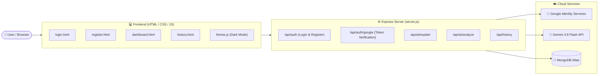

# 🤖 AI Code Explainer & Error Analyzer

[](https://ai-code-explainer-t32g.onrender.com/)
[](https://cloud.mongodb.com/)
[](https://ai.google.dev/)
[](https://console.cloud.google.com/)
[](https://nodejs.org/)

An advanced, beginner-friendly **AI-Powered Code Teacher and Debugger** that explains complex code line-by-line, identifies bugs, and provides actionable fixes in multiple regional languages (**English, Hindi, Marathi, and Hinglish**).

Live Production Link: **[https://ai-code-explainer-t32g.onrender.com/](https://ai-code-explainer-t32g.onrender.com/)**

---

## 🌟 Key Features

### 1. 🤖 AI Code Explanation
- Generates clear, structured, teacher-grade explanations for beginners.
- Includes **What the code does**, **Line-by-line breakdown**, **Core concepts used**, and **Expected output**.
- Powered by **Google Gemini 3.8 Flash** with markdown formatting and syntax highlights.

### 2. 🔍 AI Code Error Analyzer
- Scans user code for **syntax errors**, **runtime exceptions**, **logical flaws**, and **security vulnerabilities**.
- Pins down approximate line numbers and provides clean, copy-paste-ready corrected snippets.

### 3. 🌐 Multilingual Explanations
Explain and debug code in:
- 🇬🇧 **English**
- 🇮🇳 **Hindi (हिंदी)**
- 🇮🇳 **Marathi (मराठी)**
- 🇮🇳 **Hinglish (Simple conversational Hindi + English)**

### 4. 💻 Supported Programming Languages
- Python, JavaScript, Java, C++, C, PHP, HTML, CSS, SQL.

### 5. 🔐 Dual Secure Authentication
- **Google Sign-In / Sign-Up**: Official Google OAuth 2.0 / OpenID Connect flow with server-side identity verification.
- **Traditional Email & Password**: Secure passwords hashed using `bcrypt` (zero plaintext storage).
- **Duplicate Prevention & Account Linking**: Automatically links Google logins to existing email accounts.

### 6. 🗄️ MongoDB Atlas Cloud Integration
- Complete zero-data-loss migration from legacy MySQL to **MongoDB Atlas (Cloud NoSQL)**.
- Indexes on `email` and `user_id` for lightning-fast queries.
- Explanation history with full deletion capability.

### 7. 🌙 Persistent Dark / Light Theme
- Sleek floating theme toggle switch (☀️ / 🌙) on every page.
- Remembers user's preference across pages and reloads via `localStorage`.

---

## 🏗️ System Architecture



---

## 📁 Project Structure

```text
ai-code-explainer/
│
├── config/
│   ├── ai.php               # Gemini configuration (legacy PHP fallback)
│   └── api.php              # Central API bridge connector
│
├── css/
│   └── style.css            # Stylesheet with full Dark & Light mode
│
├── js/
│   └── theme.js             # Global theme switcher script
│
├── public/                  # Full-Stack Web Frontend (Served by Express)
│   ├── css/
│   │   └── style.css
│   ├── js/
│   │   └── theme.js
│   ├── index.html           # Root redirect
│   ├── login.html           # Google + Email login interface
│   ├── register.html        # Registration interface
│   ├── dashboard.html       # Code editor, Explainer & Error Analyzer
│   └── history.html         # Saved explanations viewer
│
├── scripts/
│   └── migrate.js           # MySQL dump to MongoDB Atlas migration script
│
├── .env.example             # Environment variables template
├── .gitignore               # Excludes secrets, .env, and backups
├── package.json             # Node.js dependencies & scripts
├── server.js                # Express Full-Stack Server & REST API
└── README.md                # Documentation
```

---

## 🚀 Getting Started (Local Development)

### Prerequisites
- [Node.js](https://nodejs.org/) (v18 or higher)
- [MongoDB Atlas](https://www.mongodb.com/cloud/atlas) Free Cluster
- [Google Gemini API Key](https://aistudio.google.com/)
- [Google Cloud OAuth Client ID](https://console.cloud.google.com/)

### 1. Clone the Repository
```bash
git clone https://github.com/amirhamza45acharya-ux/ai-code-explainer.git
cd ai-code-explainer
```

### 2. Install Dependencies
```bash
npm install
```

### 3. Setup Environment Variables
Create a `.env` file in the root directory (based on `.env.example`):

```env
# MongoDB Atlas Connection URI
MONGODB_URI=mongodb+srv://<username>:<password>@cluster0.xxxxx.mongodb.net/ai_code_explainer?retryWrites=true&w=majority

# Google Gemini API Key
GEMINI_API_KEY=your_gemini_api_key_here

# Google OAuth 2.0 Web Client ID
GOOGLE_CLIENT_ID=your_client_id.apps.googleusercontent.com

# Server Port & Security Secret
PORT=5000
NODE_ENV=development
API_SECRET_KEY=sec_ai_code_explainer_2026_x789
```

### 4. Run the Development Server
```bash
npm start
```
Server will start at: **`http://localhost:5000/`**

Open **`http://localhost:5000/login.html`** in your browser!

---

## 🔌 API Endpoints Reference

| Method | Endpoint | Description |
| :--- | :--- | :--- |
| `GET` | `/api/health` | Health check & MongoDB Atlas status |
| `GET` | `/api/config` | Exposes public Google Client ID |
| `POST` | `/api/auth/register` | Registers new user with bcrypt password hash |
| `POST` | `/api/auth/login` | Authenticates user with email & password |
| `POST` | `/api/auth/google` | Verifies Google ID Token & logs in / registers user |
| `POST` | `/api/ai/explain` | Generates explanation using Gemini 3.8 Flash & saves to MongoDB |
| `POST` | `/api/ai/analyze` | Analyzes code for errors using Gemini 3.8 Flash |
| `GET` | `/api/history?user_id=ID` | Fetches saved explanations for a specific user |
| `DELETE` | `/api/history/:id` | Deletes a saved explanation with ownership verification |

---

## 🛡️ Security Highlights

1. **Zero Secret Leaks**: All credentials (`GEMINI_API_KEY`, `MONGODB_URI`, secrets) are kept strictly in server-side environment variables and excluded via `.gitignore`.
2. **Server-Side Token Verification**: Google OAuth tokens are verified securely on the backend via official Google cryptographic APIs.
3. **Password Security**: Passwords are encrypted using salted `bcrypt` hashes (`PASSWORD_DEFAULT` compatibility).
4. **No Arbitrary Code Execution**: User code is purely parsed and explained as text by Gemini AI—never executed on the server machine via `exec()` or `eval()`.
5. **CSRF & Ownership Guard**: Explanations can only be deleted if the authenticated user owns the document.

---

## 👨‍💻 Author & Credits

- **Developer:** Amir Hamza
- **Project:** College Mini Project — **AI Code Explainer & Error Analyzer**
- **Repository:** [https://github.com/amirhamza45acharya-ux/ai-code-explainer](https://github.com/amirhamza45acharya-ux/ai-code-explainer)

---

## 📄 License
This project is open-source and available under the [MIT License](LICENSE).